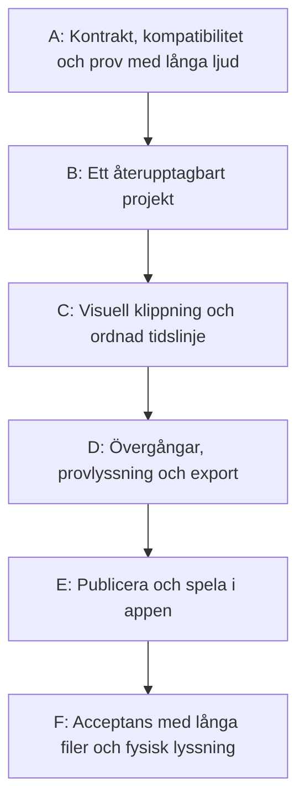

# Genomförandeplan: visuell ljudredigering

Status: **godkänd av användaren**. Även [specifikation #20](https://github.com/morre95/neuroTune/issues/20) är godkänd. Planen är nedbruten till 30 GitHub-underärenden (#21–#50) för granskning inför implementation. Implementation har inte påbörjats inom detta arbete.

Målbild: [audio-editor.md](../docs/intent/audio-editor.md).

## Beslutad leverans

En ljudredigerare i det befintliga webbgränssnittet: egna och befintliga ljud, ljudvågor, klipp i följd, mjuka övergångar, automatisk kontobunden projektsparning samt WAV-/MP3-export. Källor och färdiga kompositioner får vara upp till 60 minuter.

Samma komposition publiceras som en oföränderlig ljudprofil. I webben väljs fast längd enligt filen eller valbar längd i appen. Valbar uppspelning kan loopa en kortare fil till en längre session. Appen avslutar mjukt, även mitt i en loop; bakgrund och toner tonas ut tillsammans.

## Ärendeindex och arbetsflöde

Kanonisk specifikation: [#20](https://github.com/morre95/neuroTune/issues/20). Implementationsärenden hör hemma i GitHub Issues, inte i en lokal `tasks/todo.md`.

Planen är granskad och godkänd. Etapperna bryts ned i små GitHub-underärenden med acceptans, verifiering, uppskattade berörda filer och inbördes beroenden enligt [issue-tracker.md](../docs/agents/issue-tracker.md). Den lokala planen innehåller ett ordnat ärendeindex och kontrollpunkter; varje uppgifts egen status finns i GitHub.

Godkännandet av planen fastställer nedanstående utgångsvärden och kompatibilitetsinriktning. Prestandatrösklar, MP3-tolerans och konkreta API-/biblioteksval fastställs genom de tidiga verifieringarna. Nya avvikelser från godkänd omfattning ska redovisas innan berört arbete fortsätter.

## Godkända utgångsvärden och verifieringsbehov

| Område | Utgångsvärde i den godkända planen | Grund / kontroll |
| --- | --- | --- |
| Källor och komposition | Högst 3 600 sekunder vardera | Bekräftat användarkrav. |
| Importstorlek | Högst 1 GiB per fil | Rymmer en timme 48 kHz stereo PCM16; högre upplösning kan överskrida gränsen och ska ge begripligt fel. |
| Klipp | Högst 100 sekventiella klipp per projekt | Separat från gamla gränsen på fyra samtidiga mixspår; verifieras med ett representativt projekt. |
| Appens valbara speltid | 1–60 minuter i minutsteg, samt separat val av hela filens exakta längd; hela filen är förvalt | Godkänt genom planen. Tillåter exempelvis 20 minuters ljud i 40 minuter. |
| Autosparande | Samla redigeringar under cirka en sekund före sparförsök; visa osparat/sparar/sparat/fel | Bekräftat autosparande; intervallet är ett tekniskt förslag. Sista giltiga revision bevaras. |
| Klippskarvar | Direkt skarv som standard; valbar linjär överlappning, föreslaget intervall 0–10 sekunder | Måste rymmas inom grannklippen utan oavsiktligt trippelöverlapp. Lyssningsprov kan motivera annan kurva. |
| Appens avslut | Fem sekunders gemensam uttoning, anpassad för kort uppspelning | Förslag enligt AC-10, verifieras på Android. Uttoning ryms inom planerat slut. |
| Export | WAV 48 kHz stereo PCM16 och MP3 från samma kompositionsmaster; föreslaget MP3 320 kbit/s | Båda format är bekräftade. Kodning och formatanpassad durationstolerans verifieras före låsning av exportkontraktet. |
| Webb | Dator med mus/tangentbord; aktuella stabila Chrome, Edge och Firefox | Förslag till stödomfång. Safari/mobil kräver separat verifiering om de ska omfattas. |
| Lagring | Projektkällor bevaras så länge sparade projekt/profilversioner refererar till dem | Inga nya automatiska raderingar av användarens refererade ljud. Portabel projektfil ingår inte i föreslagen första leverans. |
| Befintligt ljud | Välj importerade källor och använd färdig profilbakgrund som en sammanslagen källa | Gamla mixrecept behåller samtidig mixning; automatisk omvandling till sekventiell tidslinje ingår inte. |
| Redigering | Trimma, ordna, ta bort och återanvänd källavsnitt; ta med ångra/gör om | Dela vid markör är ett möjligt tillägg, inte nödvändigt för bekräftat urval-avsnitt-flöde. |

Eventuella ändringar av utgångsvärdena uppdaterar planen/specifikationen innan berörd implementation. Prestandatrösklar och MP3-tolerans får inte lämnas implicit till sista acceptanstestet: de låses efter etapp A:s mätningar på dokumenterad referensmiljö. Formuleringar om förslag i tabellens kontrollkolumn anger var teknisk verifiering fortfarande krävs, inte att planens godkännande saknas.

## Arkitektur och gränser

### Projekt och oföränderliga resultat

Behåll befintligt konto, autentisering och datavolymer. Inför ett versionsmärkt redigeringsprojekt som sparas utan rendering. Skilj på ändringsbart projekt med revisionskontroll, oföränderlig renderingsögonblicksbild och publicerad profilversion.

Projektet innehåller stabila källreferenser, klippidentiteter, källgränser, ordning, övergångar, profilinställningar och längdläge. Sessionens slutliga speltid bestäms vid start och sparas separat från ljudfilens längd.

Tider bör uttryckas med kanoniska ljudframes i det nya kontraktet, med sekunder som användarvy. Det undviker att en fraktionell klipplängd tvingas till ett helt antal sekunder. Kontrakt, WAV-verifiering och appens klocka måste dela samma beslut om exakt frameantal.

Autosparande använder förväntad revision. Fördröjda svar, två flikar och kontobyte får inte ge förlorade ändringar eller felaktigt besked om att den senaste redigeringen sparats. Export och publicering väljer en bestämd sparad revision. Vid konflikt visas en möjlighet att återhämta användarens arbete; det får inte skrivas över tyst.

### Långa ljud i webbeditorn

Dagens `web/src/main.ts` hämtar hela ljudet som Blob före uppspelning. Det ska inte vara den enda vägen för entimmesredigering.

Ta fram kompakta ljudvågsdata i flera upplösningar från beständiga källor. Visa rätt upplösning för zoomnivån. Provlyssning och sökning ska kunna starta nära en vald klippgräns eller skarv utan full PCM-avkodning av alla källor i webbläsaren.

Etapp A verifierar en begränsad, autentiserad leverans av ljudfönster eller strömmande media med sökning. Mediaelement kan inte förutsättas bära dagens API-klients bearer-header; lösningen ska bevisas med aktuell dokumentation och runtimeprov. Kontoisolering och befintlig tokenhantering får inte kringgås med offentliga filer eller tokens i beständiga länkar.

Val av ljudvågskomponent och eventuell ny dependency görs efter detta prov. Använd Context7 och officiella källor för berörda bibliotek/API:er. Ingen ny frontendram eller ny autentiseringsmodell är beslutad.

### Rendering och två exportformat

Återanvänd beständiga workerjobb, leases, kontrollerade filvägar och checksummeflödet. Nytt sekvensrecept ska inte återanvända gamla mixreceptets betydelse.

Rendera klipp i ordning, med samma källgränser/övergångskurva som förhandslyssningen. Den färdiga kompositionsmastern används för WAV, MP3 och publicering. Ingen tilldelad binaural frekvensskillnad bäddas in i exporten.

Normalisering får inte beräknas oberoende på varje provlyssningsfönster, eftersom det kan ge annan balans än helfilen. Använd en gemensam beslutad nivåpolicy och redovisa när ett prov inte är från den slutliga färdiga renderingen.

Import, tillfälliga arbetsfiler, master, MP3 och förhandslyssningsdata måste räknas in i resursbudgeten. Bara höjda tidskonstanter är otillräckligt: gränser för bearbetning, lagring, leases och städning ska mätas med långa filer.

### Profilkontrakt och äldre klienter

Föreslå ett nytt explicit profil-/receptformat i stället för att ändra betydelsen av schema 1. Uppgraderad app måste kunna läsa både gamla och nya profiler. Gamla publicerade metadata och checksummor är oföränderliga.

Äldre appar ska fortsatt kunna lista och använda sina gamla profiler utan att en ny schema-version får hela listan att fallera. Innan nya profiler publiceras måste API-/klientkompatibilitet vara löst, exempelvis med explicit klientkapabilitet och separat versionsväg. Exakt API utformas i kontraktsarbetet och verifieras mot en schema-1-klient.

Färdig profilbakgrund som ny källa kräver beständigt ägarskap och referenser till originalversionen/renderingen. Den får inte bero på ett tillfälligt webbläsarobjekt eller på att ett gammalt mixrecept kan omtolkas.

### Appens längd, loopning och slut

Ersätt hårdkodade 600 sekunder i berört uppspelningsflöde med sessionens låsta framebudget. Samma budget ska styra planerad sluttid, spelad aktiv tid, slutförandestatus, bakgrundscursor och uttoning.

Fast läge använder hela filens längd en gång. Valbart läge visar längdval och loopar när tiden överstiger filen. Loopövergången och den slutliga uttoningen är olika funktioner: slututtoning måste fortsätta även om den passerar över en loopskarv. Sista uttonade bufferten måste faktiskt spelas innan ljudutmatning och tjänster stängs.

Vid schemalagt avslut ingår uttoningen i vald tid. Manuellt stopp börjar från aktuell hörbar nivå och behåller stoppstatus. Fysiska ljudavbrott kräver korrekt aktiv klocka, cursor och återupptagen slutnivå.

### Kalibrering och EEG

Befintlig blindad kalibrering och dess tidigare tiominutersprotokoll behålls. Nya profiler får inte tyst ändra en redan skapad kalibreringsserie.

Föreslagen första kompatibilitetsregel: nya längdlägen används för vanlig profiluppspelning; ett separat kalibreringsflöde visar att det fortfarande följer sitt gamla tiominutersprotokoll. Om en profil inte kan användas enligt sina längdregler ska kalibrering med den profilen avvisas begripligt, inte kringgå inställningen.

Längre eller nya protokollsessioner får inte automatiskt användas som gamla EEG-träningssessioner. Versionsmärk längd/protokoll och behåll strikt kontroll av vilka data befintliga modeller får använda. Ändrad modellträning eller längre kalibrering är inte beslutad av denna plan.

Den godkända kompatibilitetsinriktningen konkretiseras och verifieras i A2/A3 innan appdelen implementeras. Det berör vad användaren ser som meditation respektive kalibrering och får inte ändra gamla serier i efterhand.

## Ordnat index över GitHub-underärenden

Alla 30 uppgifter är öppna underärenden till #20 med native GitHub-blockeringar. Indexet är en vägvisare; status, acceptans och verifiering hålls i respektive ärende. Uppgifterna är ännu inte implementerade.

| Plan-ID | Ärende | Blockeras av | Specifikation |
| --- | --- | --- | --- |
| A1 | [#21: Verifiera minnesbegränsad webblyssning på långa ljud](https://github.com/morre95/neuroTune/issues/21) | — | AC-01/02/05 |
| A2 | [#22: Verifiera appens tidsbudget och profilkompatibilitet](https://github.com/morre95/neuroTune/issues/22) | — | AC-07–10 |
| A3 | [#23: Fastställ versionerade editor- och publiceringskontrakt](https://github.com/morre95/neuroTune/issues/23) | [#21](https://github.com/morre95/neuroTune/issues/21), [#22](https://github.com/morre95/neuroTune/issues/22) | AC-01–10 |
| B1 | [#24: Lagra projekt och revisionsbundna källreferenser](https://github.com/morre95/neuroTune/issues/24) | [#23](https://github.com/morre95/neuroTune/issues/23) | AC-06/07 |
| B2 | [#25: Skapa och återöppna ett projekt via ägarvaliderat API](https://github.com/morre95/neuroTune/issues/25) | [#24](https://github.com/morre95/neuroTune/issues/24) | AC-01/06/07 |
| B3 | [#26: Skapa och återuppta ett enkelt projekt i webben](https://github.com/morre95/neuroTune/issues/26) | [#25](https://github.com/morre95/neuroTune/issues/25) | AC-06/07 |
| B4 | [#27: Importera entimmeskällor med uppdaterade storleksgränser](https://github.com/morre95/neuroTune/issues/27) | [#23](https://github.com/morre95/neuroTune/issues/23), [#26](https://github.com/morre95/neuroTune/issues/26) | AC-01 |
| B5 | [#28: Gör autosparande säkert vid fortsatt redigering och nätfel](https://github.com/morre95/neuroTune/issues/28) | [#26](https://github.com/morre95/neuroTune/issues/26) | AC-06 |
| C1 | [#29: Leverera kompakta ljudvågsdata för långa källor](https://github.com/morre95/neuroTune/issues/29) | [#21](https://github.com/morre95/neuroTune/issues/21), [#27](https://github.com/morre95/neuroTune/issues/27) | AC-01/02/07 |
| C2 | [#30: Välj och trimma ett klipp visuellt på tidslinjen](https://github.com/morre95/neuroTune/issues/30) | [#29](https://github.com/morre95/neuroTune/issues/29), [#28](https://github.com/morre95/neuroTune/issues/28) | AC-02/06 |
| C3 | [#31: Ordna flera klipp med ångra och gör om](https://github.com/morre95/neuroTune/issues/31) | [#30](https://github.com/morre95/neuroTune/issues/30) | AC-02/03/06 |
| C4 | [#32: Använd befintlig profilbakgrund som ljudkälla](https://github.com/morre95/neuroTune/issues/32) | [#25](https://github.com/morre95/neuroTune/issues/25), [#31](https://github.com/morre95/neuroTune/issues/31) | AC-01/07 |
| D1 | [#33: Rendera en revisionsbunden sekvens till full WAV](https://github.com/morre95/neuroTune/issues/33) | [#32](https://github.com/morre95/neuroTune/issues/32) | AC-03/05/07 |
| D2 | [#34: Provlyssna och sök på hela kompositionens tidslinje](https://github.com/morre95/neuroTune/issues/34) | [#33](https://github.com/morre95/neuroTune/issues/33) | AC-05/07 |
| D3 | [#35: Redigera och rendera mjuka övergångar mellan klipp](https://github.com/morre95/neuroTune/issues/35) | [#34](https://github.com/morre95/neuroTune/issues/34) | AC-04/05 |
| D4 | [#36: Exportera och återimportera både WAV och MP3](https://github.com/morre95/neuroTune/issues/36) | [#35](https://github.com/morre95/neuroTune/issues/35) | AC-05 |
| E1 | [#37: Läs nya profilversioner och exakta WAV-frames i appen](https://github.com/morre95/neuroTune/issues/37) | [#23](https://github.com/morre95/neuroTune/issues/23), [#22](https://github.com/morre95/neuroTune/issues/22) | AC-07/08/09 |
| E2 | [#38: Publicera projektversion som kompatibel ljudprofil](https://github.com/morre95/neuroTune/issues/38) | [#36](https://github.com/morre95/neuroTune/issues/36), [#37](https://github.com/morre95/neuroTune/issues/37) | AC-07/08/09 |
| E3 | [#39: Hämta nya profiler och längdpolicy till offlinebiblioteket](https://github.com/morre95/neuroTune/issues/39) | [#38](https://github.com/morre95/neuroTune/issues/38) | AC-07/08/09 |
| E4 | [#40: Inför låst framebudget i meditationsprotokollet](https://github.com/morre95/neuroTune/issues/40) | [#23](https://github.com/morre95/neuroTune/issues/23), [#37](https://github.com/morre95/neuroTune/issues/37) | AC-09 |
| E5 | [#41: Synka nya sessionslängder utan att ändra gamla EEG-gates](https://github.com/morre95/neuroTune/issues/41) | [#40](https://github.com/morre95/neuroTune/issues/40) | AC-07/09 |
| E6 | [#42: Spela fast profillängd med rätt aktiv sessionstid](https://github.com/morre95/neuroTune/issues/42) | [#39](https://github.com/morre95/neuroTune/issues/39), [#40](https://github.com/morre95/neuroTune/issues/40), [#41](https://github.com/morre95/neuroTune/issues/41) | AC-08/09 |
| E7 | [#43: Välj längdläge i webben och speltid i appen](https://github.com/morre95/neuroTune/issues/43) | [#38](https://github.com/morre95/neuroTune/issues/38), [#42](https://github.com/morre95/neuroTune/issues/42) | AC-08/09 |
| E8 | [#44: Visa och synka rätt längd genom hela appsessionen](https://github.com/morre95/neuroTune/issues/44) | [#43](https://github.com/morre95/neuroTune/issues/43) | AC-09 |
| E9 | [#45: Loopa kortare bakgrund till vald aktiv speltid](https://github.com/morre95/neuroTune/issues/45) | [#44](https://github.com/morre95/neuroTune/issues/44) | AC-09 |
| E10 | [#46: Tona ut hela appmixen mjukt vid slut och stopp](https://github.com/morre95/neuroTune/issues/46) | [#45](https://github.com/morre95/neuroTune/issues/45) | AC-10 |
| E11 | [#47: Behåll tydligt separat tiominuterskalibrering](https://github.com/morre95/neuroTune/issues/47) | [#43](https://github.com/morre95/neuroTune/issues/43), [#41](https://github.com/morre95/neuroTune/issues/41) | AC-07/09 |
| F1 | [#48: Verifiera verkligt editorflöde med båda exportformaten](https://github.com/morre95/neuroTune/issues/48) | [#36](https://github.com/morre95/neuroTune/issues/36), [#38](https://github.com/morre95/neuroTune/issues/38) | AC-01–08 |
| F2 | [#49: Godkänn entimmesprojekt mot dokumenterad resursbudget](https://github.com/morre95/neuroTune/issues/49) | [#48](https://github.com/morre95/neuroTune/issues/48), [#46](https://github.com/morre95/neuroTune/issues/46), [#47](https://github.com/morre95/neuroTune/issues/47) | AC-01–10 |
| F3 | [#50: Verifiera mjukt avslut i fysisk Android-app och avsluta dokumentationen](https://github.com/morre95/neuroTune/issues/50) | [#49](https://github.com/morre95/neuroTune/issues/49) | AC-08–10 |

Första frontier efter granskning av nedbrytningen: [A1 / #21](https://github.com/morre95/neuroTune/issues/21) och [A2 / #22](https://github.com/morre95/neuroTune/issues/22). Inga uppgifter har claimats eller markerats klara i planeringsarbetet.

## Kontrollpunkter för genomförandet

Efter varje grupp om tre uppgifter: kör relevanta fokuserade kontroller, verifiera användarflödet och granska resultatet med användaren innan nästa berörda etapp. Detta är kontrollpunkter, inte en parallell lokal statuslista för implementationstickets.

- [ ] K1, efter [A1 / #21](https://github.com/morre95/neuroTune/issues/21), [A2 / #22](https://github.com/morre95/neuroTune/issues/22), [A3 / #23](https://github.com/morre95/neuroTune/issues/23): Kontrakt, minnesbegränsad lyssningsväg, profil-/sessionskompatibilitet och mätbar referensmiljö är dokumenterade och granskade.
- [ ] K2, efter [B1 / #24](https://github.com/morre95/neuroTune/issues/24), [B2 / #25](https://github.com/morre95/neuroTune/issues/25), [B3 / #26](https://github.com/morre95/neuroTune/issues/26): Ett namngivet kontoägt projekt kan skapas och återöppnas utan rendering; migrationer och ägarskap verifieras.
- [ ] K3, efter [B4 / #27](https://github.com/morre95/neuroTune/issues/27), [B5 / #28](https://github.com/morre95/neuroTune/issues/28), [C1 / #29](https://github.com/morre95/neuroTune/issues/29): Entimmesimport, robust autosparande och kompakta ljudvågsdata klarar relevanta tester och resursgränser.
- [ ] K4, efter [C2 / #30](https://github.com/morre95/neuroTune/issues/30), [C3 / #31](https://github.com/morre95/neuroTune/issues/31), [C4 / #32](https://github.com/morre95/neuroTune/issues/32): Visuell trimning, flera klipp, ångra/gör om och profilbakgrund som källa fungerar genom spara/återöppna, även med tangentbord.
- [ ] K5, efter [D1 / #33](https://github.com/morre95/neuroTune/issues/33), [D2 / #34](https://github.com/morre95/neuroTune/issues/34), [D3 / #35](https://github.com/morre95/neuroTune/issues/35): Full WAV, sökbar provlyssning och mjuka klippskarvar har korrekt signal, frameantal och nivåpolicy.
- [ ] K6, efter [D4 / #36](https://github.com/morre95/neuroTune/issues/36), [E1 / #37](https://github.com/morre95/neuroTune/issues/37), [E2 / #38](https://github.com/morre95/neuroTune/issues/38): Båda exportformaten och publicering använder samma revision/master; gamla klienter och profiler fortsätter fungera.
- [ ] K7, efter [E3 / #39](https://github.com/morre95/neuroTune/issues/39), [E4 / #40](https://github.com/morre95/neuroTune/issues/40), [E5 / #41](https://github.com/morre95/neuroTune/issues/41): Offlinebibliotek, ny framebudget och backendens sessions-/feedbackgränser fungerar utan förändrade gamla EEG-gates.
- [ ] K8, efter [E6 / #42](https://github.com/morre95/neuroTune/issues/42), [E7 / #43](https://github.com/morre95/neuroTune/issues/43), [E8 / #44](https://github.com/morre95/neuroTune/issues/44): Fast/valbar längd visas korrekt och vald budget följer controller, UI, manifest och synkkö.
- [ ] K9, efter [E9 / #45](https://github.com/morre95/neuroTune/issues/45), [E10 / #46](https://github.com/morre95/neuroTune/issues/46), [E11 / #47](https://github.com/morre95/neuroTune/issues/47): Loopning, gemensam mjuk slututtoning och separat kalibrering klarar ljud-, avbrotts- och statusregressioner.
- [ ] K10, efter [F1 / #48](https://github.com/morre95/neuroTune/issues/48), [F2 / #49](https://github.com/morre95/neuroTune/issues/49), [F3 / #50](https://github.com/morre95/neuroTune/issues/50): Verklig editor/API/worker, entimmes-/100-klippsprojekt och fysisk Android-lyssning har dokumenterad acceptans för AC-01–AC-10.

## Beroenden och leveransordning



### A. Tidiga riskprov och kontraktsbeslut

Verifiera lång import, minnesbegränsad webbläsarlyssning och mobilens nya tidsbudget i isolerade prov. Mät representativt entimmesljud, prototypa revisionskontroll och identifiera alla schema-1-konsumenter.

Fastställ projekt-/render-/profilkontrakt, migration/kompatibilitet, numrerade gränser och mätbar referensmiljö. Avgör hur gamla appar och tidigare sessioner skyddas.

**Kontrollpunkt:** granskade kontrakt och dokumenterade prov; inga förslag ska ha smugit in som ändrad betydelse av äldre data. Verifierad väg för autentiserad sökning/lyssning på lång fil.

### B. Ett projekt som går att återuppta

Första tunna leveransen: skapa ett projekt från en färdig befintlig källa, lägg ett klipp, namnge, spara automatiskt, stäng och öppna igen. Lägg till backendlagring, revisioner, kontoägarskap och synlig sparstatus i samma användarflöde.

Utöka med import av lång källa och beständiga referenser så att en vald del efter den tionde minuten återställs korrekt. Hantera sparfel, konflikter och kontobyte.

**Kontrollpunkt:** återöppning utan ny filväljning eller rendering, inklusive backendomstart; kontoisolering och migrationsregressioner godkända. Täcker främst AC-01/06/07.

### C. Klipp visuellt på tidslinjen

Utöka det fungerande projektflödet med ljudvågor, zoom, urval, dragning till tidslinje och visuell justering av klippgränser. Lägg till fler klipp från flera källor, omordning, borttagning och tangentbordsalternativ.

Dela internt i små användarskivor: ett synligt redigerbart klipp, flera omordningsbara klipp, därefter ångra/gör om och större testprojekt. Varje skiva ska kunna sparas/återöppnas och lämna ett fungerande flöde.

**Kontrollpunkt:** flera källor och upprepade avsnitt ger rätt ordning/duration, synlig sparstatus och användbar fokus-/tangentbordshantering. Täcker AC-02/03/06.

### D. Lyssna på och exportera kompositionen

Först en verifierbar sekvens utan överlapp med samma resultat i provlyssning och hel WAV. Lägg sedan till skarvvisa mjuka övergångar med validering, gemensam nivåpolicy och korrekt totalduration.

Utöka med MP3-export, nedladdningsstatus och återimport. Ett gammalt renderjobb får inte visas som resultat av en senare redigering. Verifiera avsnitt långt efter de första trettio sekunderna.

**Kontrollpunkt:** provlyssna, spara och exportera en bestämd revision; signaltester bevisar klippordning, längd, kanaler, övergång och format. Täcker AC-04/05 samt exportdelar av AC-07.

### E. Publicera och spela hela resultatet i appen

Inför nytt profilformat i gemensamma kontrakt och uppgraderad app innan backend exponerar det till rätt klienter. Publicera ett sparat projekt med längdläget valt i webben och verifiera appens lista, preview, nedladdning, checksumma och offlinecache.

Leverera fast längd först, därefter valbart längdval och loopning. Inför mjukt avslut genom hela uppspelningskedjan, inklusive manuell stoppramp, bufferttömning, status och resurser. Håll kalibrering/inlärning separerade enligt granskat protokollbeslut.

**Kontrollpunkt:** båda lägena från webben till faktisk appuppspelning; gammal klient och gamla profiler fungerar; paus/ljudavbrott och offline återupptar rätt tid och position. Täcker AC-08/09/10.

### F. Sammanhängande acceptans och dokumentation

Verifiera verklig import/API/worker/browser, två exportformat och återöppning. Kör ett dokumenterat entimmesprojekt enligt beslutad resursbudget.

Genomför fysisk Android-lyssning: fast filslut, 20-minutersljud i 40 minuter, vald tid mitt i repetition, slut nära loopskarv och manuellt stopp. Kontrollera bakgrund och toner tillsammans och att sista uttonade ljudet faktiskt hörs.

Uppdatera användar- och driftdokumentation, kontrakt och acceptansprotokoll. Tidigare dokumenterad hårdvaruacceptans får inte beskrivas som acceptans för den nya koden.

**Kontrollpunkt:** varje AC-01–AC-10 har verifiering/evidens, kvarvarande begränsningar är uttryckliga och inga tidigare skydd eller tester har sänkts.

## Verifiering under arbetet

Befintliga kommandon från repo-roten, med utvecklingsmiljö och relevanta beroenden installerade:

```bash
npm --prefix web run build
npm --prefix web test
npm --prefix web run test:acceptance
python -m pytest backend/tests/test_audio.py backend/tests/test_profiles.py backend/tests/test_migrations.py -q
```

Kör `dart test` från `packages/neurotune_core` och `flutter test` från `app` för berörda kontrakt, bibliotek och sessionsflöden. Nya fokuserade testkommandon namnges i respektive framtida implementationsticket.

Utgå bland annat från `backend/tests/test_audio.py`, `test_profiles.py`, `web/tests/acceptance.spec.ts`, `packages/neurotune_core/lib/src/audio_profile.dart`, `app/lib/data/canonical_wave.dart`, `app/test/profile_library_test.dart`, `meditation_audio_test.dart`, `meditation_session_test.dart`, `meditation_interruptions_test.dart` och `meditation_output_lifecycle_test.dart`.

Planeringsarbetet i sig kör inte dessa runtime-/hårdvarutester och utgör inte evidens för att de nya kraven redan fungerar.

## Risker och hantering

| Risk | Konsekvens | Hantering |
| --- | --- | --- |
| Full avkodning/hämtning av flera entimmeskällor | Hög minnesåtgång och lång starttid | Kompakta ljudvågsdata och begränsad ljudleverans; riskprov före UI-val. |
| Ny profil i gamla list-endpoints | Hela gamla appbiblioteket kan sluta fungera | Klientkapabilitet/versionsväg, oförändrat schema 1 och test mot gammal klient. |
| Heltalssekunder i gamla kontrakt | Avkortning eller fel checksumme-/längdverifiering | Auktoritativt frameantal i nya format; samordnade kontrakt och verifierare. |
| Autosparande under redigering | Äldre revision skriver över ny eller felaktig sparstatus | Revision/kontogeneration och tester med fördröjda svar, konflikt och nätfel. |
| Stora original, intermediärer och dubbla exporter | Diskbrist, timeout eller återtagna workerjobb | Budgetera hela jobbets lagring, mät tidsgränser/leases och städa säkert. |
| Uttoning produceras men ljudsink stängs för tidigt | Fortsatt tvärt avslut trots gröna sampletester | Verifiera spelad slutbuffert och lyssna på fysisk enhet. |
| Loopskarv återställer slutnivån | Hörbar uppgång eller extra repetition vid slut | Separat monoton slutkurva från loopkurva och prov vid skarvens randfall. |
| Längre session tas som gammal kalibrering/träning | Fel status eller förändrat inlärningsunderlag | Versionsmärkt protokoll och oförändrade gates för tidigare data. |

## Nästa steg

Planen med 100 klipp, 1 GiB per fil, valbar appspeltid upp till 60 minuter och kompatibilitetsinriktningen för kalibrering är godkänd. Granska de konkreta underärendenas avgränsningar och beroenden inför implementation, utan en ny intervju om redan beslutade krav.

Nästa genomförandesteg är de oblockerade riskproven A1/A2. Uppgiftsnedbrytningen granskas enligt projektets specdrivna fasövergång före kodarbetet.
